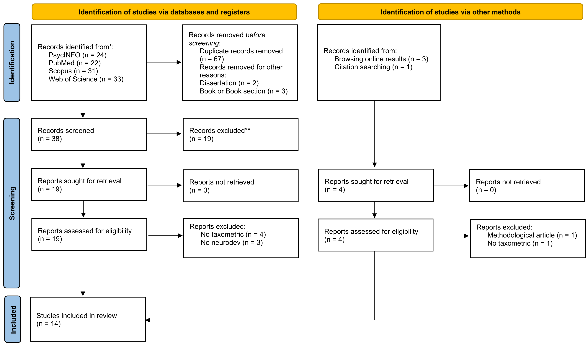
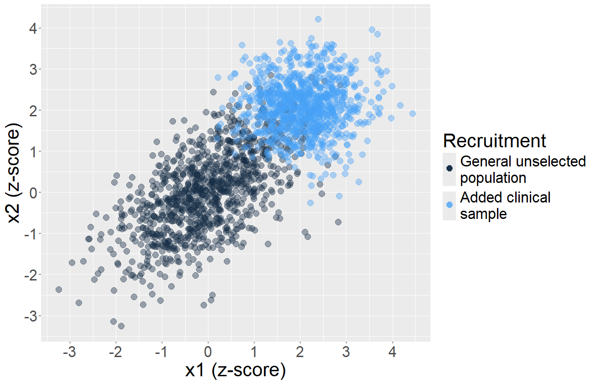

::: {.topbar}
[Manuscript](Manuscript-taxometric-NDCs.pdf)
[Preregistration (OSF)](https://osf.io/65y9g/?view_only=91e97c6b00dc444abb83fefcf67cbac0)
[Materials (OSF)](https://osf.io/ys5ad/?view_only=0e2812acfabf43fc8af01f883c7331ba)
[GitHub](https://github.com/EnricoToffalini/Taxometrics-Neurodevelopmental-Disorders)
:::

::: {.head}
<h1>Tails or Types?</h1>

A critical systematic review of taxometric studies of neurodevelopmental conditions

Enrico Toffalini1, Margherita Calderan1, Riccardo Pagan2, Valentina Tobia3, Edmund Sonuga-Barke4

1Department of General Psychology, University of Padua; 2Department of Social and Developmental Psychology, University of Padua; 3Vita-Salute San Raffaele University, Milan; 4King's College London

<a class="primary" href="Manuscript-taxometric-NDCs.pdf"><i class="bi bi-file-earmark-pdf"></i>Manuscript (PDF)</a>
<a href="https://osf.io/65y9g/?view_only=91e97c6b00dc444abb83fefcf67cbac0"><i class="bi bi-lock"></i>Preregistration</a>
<a href="https://osf.io/ys5ad/?view_only=0e2812acfabf43fc8af01f883c7331ba"><i class="bi bi-archive"></i>OSF materials</a>
<a href="https://github.com/EnricoToffalini/Taxometrics-Neurodevelopmental-Disorders"><i class="bi bi-github"></i>GitHub</a>

:::

::: {.facts}

14

articles included

4

databases searched

4

condition areas: autism, ADHD, LD, language

Prereg.

protocol on OSF

:::

## About the project

Taxometric analysis tests whether the latent structure underlying a clinical condition is **categorical (taxonic)** or **dimensional**. This project systematically reviews published taxometric studies of neurodevelopmental conditions (autism, ADHD, learning disorders, language impairment), with a specific focus on methodological threats to validity, above all **artificial admixture**: combining subsamples recruited in different ways (e.g., clinical and control groups) into a single dataset. A Monte Carlo simulation shows how admixture can produce spurious taxonic findings from purely dimensional data.

::: {.abstract}
**Background.** Taxometric analysis is specifically designed to test whether the latent structures underlying clinical conditions are categorical (taxonic) or dimensional in nature. Despite its relevance to ongoing debates about the nature of neurodevelopmental conditions, its application to this field has been limited.
**Methods.** We conducted a preregistered systematic review of published taxometric studies on autism, ADHD, learning disorders, and language impairment, with a focus on methodological threats such as artificial admixture. A Monte Carlo simulation was run to illustrate how admixture can yield false taxonic results from dimensional data.
**Results.** Fourteen articles met the inclusion criteria. Studies of ADHD and language impairment largely supported dimensional models, whereas most studies of autism and conditions' subtypes supported categorical models. No studies targeted learning disorders as taxa. Admixture was common in studies reaching taxonic conclusions, especially for autism. In simulations, admixture was consistently associated with false positive taxonic findings.
**Conclusions.** Evidence for categorical structure, especially in autism and disorders' subtypes, is likely undermined by methodological limitations, particularly admixture. We advocate for more high-quality taxometric studies in this area.
:::

## Key figures

::: {.figs}

:::

## Explore the materials

::: {.cards}

::: {.card2}
### <i class="bi bi-file-earmark-text"></i>Manuscript

Latest version of the paper and its Quarto source (APA style, <code>apaquarto</code>).

- [Manuscript, latest version (PDF)](Manuscript-taxometric-NDCs.pdf)
- [Earlier draft (PDF)](Paper-v0/Paper.pdf)
- [Quarto source `Paper.qmd`](https://github.com/EnricoToffalini/Taxometrics-Neurodevelopmental-Disorders/blob/main/Paper-v0/Paper.qmd)
- [References `references.bib`](https://github.com/EnricoToffalini/Taxometrics-Neurodevelopmental-Disorders/blob/main/Paper-v0/references.bib)
- [Summary table of reviewed studies (xlsx)](Paper-v0/Tables/Review-Summary.xlsx)
:::

::: {.card2}
### <i class="bi bi-clipboard-check"></i>Preregistration

Review protocol registered before data extraction.

- [Protocol (PDF)](Literature-review/Preregistration/Preregistration-protocol-Taxometrics-NDD.pdf)
- [Protocol source (Quarto)](https://github.com/EnricoToffalini/Taxometrics-Neurodevelopmental-Disorders/blob/main/Literature-review/Preregistration/Preregistration-protocol-Taxometrics-NDD.Qmd)
- [Registration on OSF](https://osf.io/65y9g/?view_only=91e97c6b00dc444abb83fefcf67cbac0)
- [PRISMA flow diagram (PDF)](Literature-review/PRISMA_flow_diagram.pdf)
:::

::: {.card2}
### <i class="bi bi-search"></i>Search records raw data

Records exported from the bibliographic databases.

- Main search: [PubMed](Literature-review/data/raw/PubMed.csv) · [PsycINFO](Literature-review/data/raw/PsycINFO.csv) · [Scopus](Literature-review/data/raw/Scopus.csv) · [Web of Science](Literature-review/data/raw/WoS.csv)
- Supplementary search: [PubMed](Literature-review/data/raw/supplementary-search-records/pubmed-extra.csv) · [PsycINFO](Literature-review/data/raw/supplementary-search-records/psycinfo-extra.csv) · [Scopus](Literature-review/data/raw/supplementary-search-records/scopus-extra.csv) · [Web of Science](Literature-review/data/raw/supplementary-search-records/webofscience-extra.csv)
:::

::: {.card2}
### <i class="bi bi-table"></i>Screening & extraction processed data

Merged, deduplicated and screened records, plus coded study characteristics.

- [All records `df_all.csv`](Literature-review/data/processed/df_all.csv)
- [Deduplicated `df_nodup.csv`](Literature-review/data/processed/df_nodup.csv)
- [Screening `df_ok_screening.csv`](Literature-review/data/processed/df_ok_screening.csv) · [`df_ok.csv`](Literature-review/data/processed/df_ok.csv)
- [Supplementary search `df_supplementary-search.csv`](Literature-review/data/processed/df_supplementary-search.csv)
- [Data extraction (xlsx)](Literature-review/data/data_extraction.xlsx) · [Data dictionary (xlsx)](Literature-review/data/data_dictionary.xlsx)
:::

::: {.card2}
### <i class="bi bi-code-slash"></i>R code

Scripts to reproduce the review pipeline and the simulation, in order.

- [`0 preprocessing-literature-review.R`](https://github.com/EnricoToffalini/Taxometrics-Neurodevelopmental-Disorders/blob/main/R/0%20preprocessing-literature-review.R) — merge & deduplicate records
- [`1 analysis-review-data.R`](https://github.com/EnricoToffalini/Taxometrics-Neurodevelopmental-Disorders/blob/main/R/1%20analysis-review-data.R) — analyse extracted data
- [`2 simulate-artificial-admixture.R`](https://github.com/EnricoToffalini/Taxometrics-Neurodevelopmental-Disorders/blob/main/R/2%20simulate-artificial-admixture.R) — Monte Carlo simulation
- [Saved simulation results (`.RData`)](R/simulateAdmixtResults.RData)
:::

::: {.card2}
### <i class="bi bi-arrow-repeat"></i>Reproduce

Everything runs from the repository root.

1. Clone or [download the repository (zip)](https://github.com/EnricoToffalini/Taxometrics-Neurodevelopmental-Disorders/archive/refs/heads/main.zip)
2. Open `Taxometrics-Neurodevelopmental-Disorders.Rproj` in RStudio
3. Run the scripts in `R/` in order (0 → 1 → 2)
:::

:::

## Funding

Project 2022KBW99S *"Tails or types? Testing the dimensional hypothesis in neurodevelopmental disorders"*, funded by Next Generation EU, Mission 4, Component 1, CUP C53D23004210006.

## Contact

Enrico Toffalini, Department of General Psychology, University of Padua — [enrico.toffalini@unipd.it](mailto:enrico.toffalini@unipd.it) · ORCID [0000-0002-1404-5133](https://orcid.org/0000-0002-1404-5133)

<footer class="site">
Built with [Quarto](https://quarto.org) · Source of this page: [`index.qmd`](https://github.com/EnricoToffalini/Taxometrics-Neurodevelopmental-Disorders/blob/main/index.qmd)
</footer>
